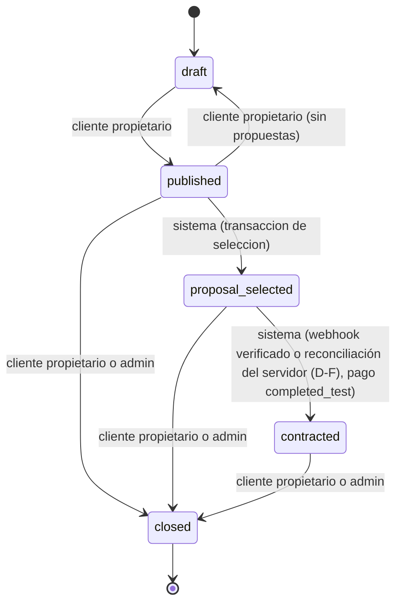
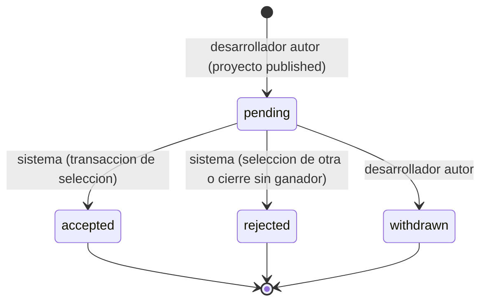
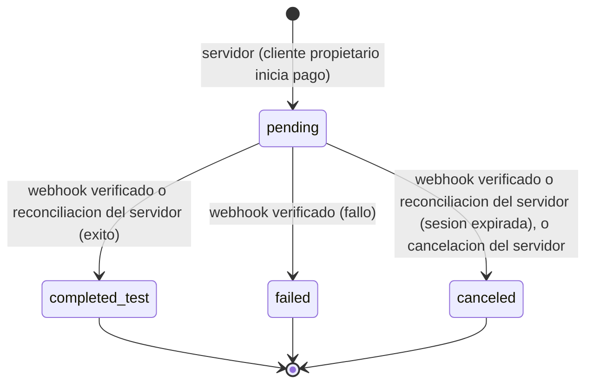
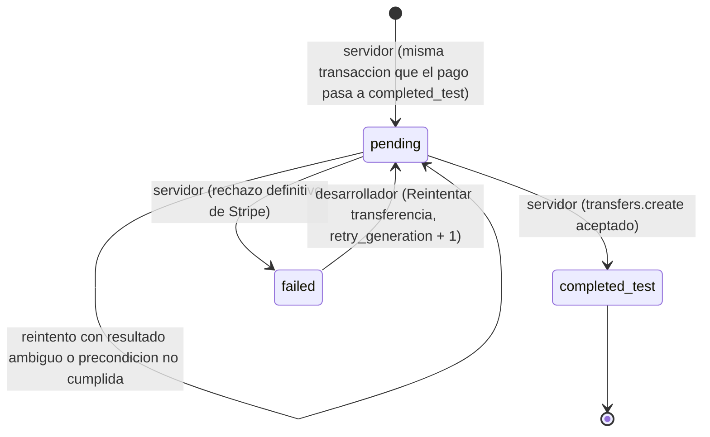
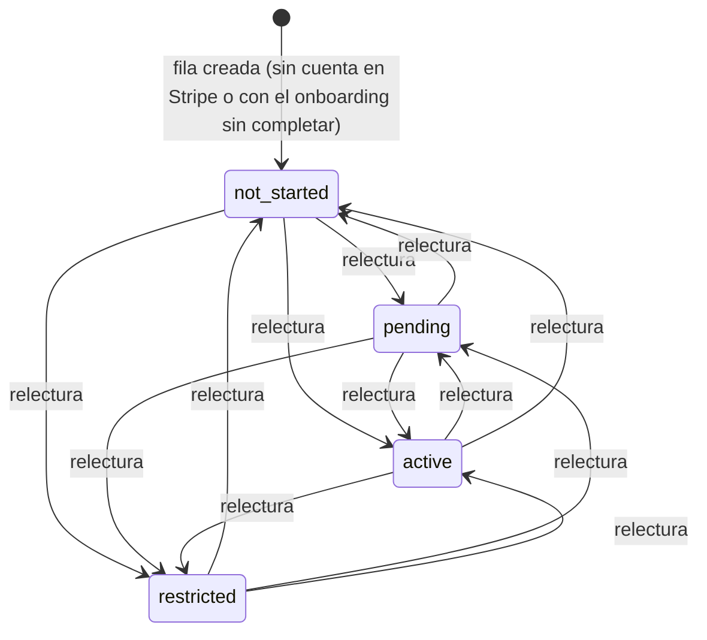

# Máquinas de estado

Define las 4 máquinas de estado de Nexora: proyecto, propuesta, intento de pago y transferencia. Los identificadores de estado son canónicos (inglés, snake_case) y la columna "Etiqueta" es el texto de UI aprobado. Origen normativo: `docs/specs/002-product-domain-and-architecture.md` (RF4 y sección 9). `system-design.md §5` solo resume y enlaza este documento.

Reglas transversales:

- Ninguna transición a `completed_test` (pago) ni a `contracted` (proyecto) la dispara la página de retorno del navegador ni una acción del cliente. Ambas dependen de un webhook de Stripe verificado en servidor (firma válida) o de una lectura autenticada de la sesión hecha por el servidor (botón «Actualizar estado», 010 D-F).
- Todo estado de pago es de Test Mode (`livemode=false`) y nunca se presenta como dinero real.
- Las transiciones entre módulos se hacen mediante funciones de transición expuestas por el módulo dueño, nunca por SQL directo desde otro módulo.

---

## 1. Proyecto (`project.status`)

| Id | Etiqueta |
|---|---|
| `draft` | Borrador |
| `published` | Publicado |
| `proposal_selected` | Con propuesta seleccionada · pendiente de pago |
| `contracted` | En contratación |
| `closed` | Cerrado |

| Transición | Quién la dispara | Condición |
|---|---|---|
| `draft -> published` | Cliente propietario | Datos del proyecto válidos (spec 005) |
| `published -> draft` | Cliente propietario | Solo si no tiene propuestas (D3) |
| `published -> proposal_selected` | Sistema, dentro de la transacción de selección iniciada por el cliente propietario | El proyecto sigue en `published`; la propuesta seleccionada está en `pending` |
| `proposal_selected -> contracted` | Sistema, tras procesar un webhook verificado o una reconciliación del servidor (D-F) que deja el pago en `completed_test` | Intento de pago asociado a la propuesta ganadora. Nunca por el navegador ni por acción del cliente |
| `published -> closed` | Cliente propietario (o administrador) | Cierre manual; las propuestas `pending` pasan a `rejected` |
| `proposal_selected -> closed` | Cliente propietario (o administrador) | Cancelación antes de pagar; solo mientras no exista pago `completed_test`. Con un intento `pending`, se cancela o se espera su resolución (D2; detalle en specs 010/012) |
| `contracted -> closed` | Cliente propietario (o administrador) | Cierre manual tras la contratación |

Estado terminal: `closed`.

Notas:

- `draft` no pasa a `closed` en el MVP: un borrador se edita o se descarta (el borrado queda para la spec 005).
- Solo `published` admite nuevas propuestas.
- No se reabre la selección (`proposal_selected -> published`) en el MVP (D2).

---

## 2. Propuesta (`proposal.status`)

| Id | Etiqueta |
|---|---|
| `pending` | Pendiente |
| `accepted` | Aceptada |
| `rejected` | Rechazada |
| `withdrawn` | Retirada |

| Transición | Quién la dispara | Condición |
|---|---|---|
| (creación) -> `pending` | Desarrollador autor | Proyecto en `published`; usuario con rol `developer`; no es el propietario del proyecto; máximo una propuesta por desarrollador por proyecto (D5) |
| `pending -> accepted` | Sistema, dentro de la transacción de selección (acción del cliente propietario) | Exactamente una por proyecto |
| `pending -> rejected` | Sistema, en la misma transacción de selección para las demás; o al cerrarse el proyecto sin ganador | Proyecto cerrado o con otra propuesta seleccionada |
| `pending -> withdrawn` | Desarrollador autor | Solo mientras el proyecto está `published` |

Estados terminales: `accepted`, `rejected`, `withdrawn`. Una propuesta `accepted` no se retira en el MVP.

---

## 3. Intento de pago (`paymentAttempt.status`)

La ausencia de intento equivale a "No iniciado" (no es un estado almacenado).

| Id | Etiqueta |
|---|---|
| `pending` | Pendiente |
| `completed_test` | Completado en Test Mode |
| `failed` | Fallido |
| `canceled` | Cancelado |

| Transición | Quién la dispara | Condición |
|---|---|---|
| (creación) -> `pending` | Servidor, al pedir el cliente propietario iniciar el pago | Proyecto en `proposal_selected`; no existe otro intento `pending`/`completed_test` para el proyecto. Importe y moneda salen de la propuesta ganadora guardada en servidor |
| `pending -> completed_test` | Webhook de Stripe verificado (firma válida) o reconciliación del servidor (D-F) | Evento de éxito o sesión pagada leída de la API. La página de retorno nunca dispara esta transición |
| `pending -> failed` | Webhook de Stripe verificado | Evento de fallo de pago |
| `pending -> canceled` | Webhook de Stripe verificado o reconciliación del servidor (D-F) (sesión expirada) o cancelación explícita del servidor al abandonar la sesión, o cancelación explícita del cliente (spec 012): solo con la sesión `expired` confirmada por Stripe (`sessions.expire` o relectura autenticada), o con un intento sin sesión fuera de la ventana de reanudación | La redirección de cancelación del navegador solo informa; no cambia el estado por sí sola |

Estados terminales: `completed_test`, `failed`, `canceled`.

Nota: la reconciliación del servidor (botón «Actualizar estado», 010 D-F) solo produce `completed_test` o `canceled`; nunca `failed`, que solo llega por el evento `checkout.session.async_payment_failed`.

Reglas:

- Un reintento crea un intento nuevo.
- Un evento tardío o repetido nunca revierte `completed_test` ni reabre un estado terminal.
- Mapeo de eventos (spec 010):
  - `checkout.session.completed` y `checkout.session.async_payment_succeeded` con `payment_status = 'paid'`: `pending -> completed_test` y `proposal_selected -> contracted`. Con `completed` y `payment_status` distinto de `paid` (método asíncrono) no cambia nada hasta el evento asíncrono.
  - `checkout.session.async_payment_failed`: `pending -> failed`; el proyecto sigue en `proposal_selected`.
  - `checkout.session.expired`: `pending -> canceled`; el proyecto sigue en `proposal_selected`.
  - Intento no `pending`, no encontrado o con importe/moneda distintos: se ignora sin cambios. `payment_intent.payment_failed` y cualquier otro evento no se manejan: un rechazo de tarjeta no termina la sesión, así que no produce `failed`.
  - La reconciliación "Actualizar estado" lee la sesión en la API de Stripe y aplica las mismas reglas.

---

## 4. Transferencia al desarrollador (`transferStatus`)

La transferencia es independiente del pago: son estados y entidades distintos. Que el pago esté en `completed_test` no implica que el desarrollador haya recibido nada. Desde la spec 011b el estado se **almacena** en `developer_transfers.status` (sustituye a la máquina derivada `not_applicable` / `pending_implementation` / `simulated`). La ausencia de fila equivale a "sin transferencia" (el pago aún no está `completed_test`).

| Id | Etiqueta | Cuándo |
|---|---|---|
| `pending` | Pendiente | La fila nace con el pago; aún no hay transferencia en Stripe (cuenta no activa, pago sin liquidar, error ambiguo o transitorio). Reintentable |
| `completed_test` | Completada en Test Mode | Stripe aceptó `transfers.create`; guarda `stripe_transfer_id`. Terminal |
| `failed` | Fallida | Rechazo definitivo de Stripe (`STRIPE_REJECTED`) o `livemode` verdadero (`LIVEMODE_REJECTED`). Reintento manual del desarrollador |

| Transición | Quién la dispara | Condición |
|---|---|---|
| (creación) -> `pending` | `applySessionOutcome`, en la misma transacción que `pending -> completed_test` del pago (webhook verificado o reconciliación) | Una fila por pago (`UNIQUE payment_attempt_id`); también si el proyecto no estaba en `proposal_selected` (011b D-G). Sin llamadas a Stripe dentro de la transacción |
| `pending -> completed_test` | Servidor, tras el commit del pago o en un reintento | Cuenta conectada releída y `active`; PaymentIntent `succeeded` con cargo; `transfers.create` (importe completo de la BD, `source_transaction`, clave `nexora:transfer:<id>:<generación>`) devuelve `tr_...` con `livemode = false` |
| `pending -> pending` | Servidor | Cuenta no `active` o no releíble, pago sin liquidar, Stripe no disponible, respuesta inválida o Stripe sin configurar: se guarda el motivo en `last_error_code` |
| `pending -> failed` | Servidor | Rechazo definitivo de Stripe (`StripeInvalidRequestError`, `StripeAuthenticationError`, `StripePermissionError`) o `livemode` verdadero |
| `failed -> pending` | Desarrollador dueño (acción `transfer.retry`) | Solo sus filas; sube `retry_generation` y, por tanto, cambia la clave de idempotencia |

Reglas:

- `completed_test` es terminal y nunca se revierte. El pago y la transferencia siguen siendo independientes (I3).
- Reintento automático sin cron (011b D-F): tras confirmar el pago, y cuando el desarrollador vuelve del onboarding o pulsa "Actualizar estado" con la cuenta `active` (solo sus `pending`). Reintento manual: "Reintentar transferencia" (sus `pending` y `failed`, máximo 10 por pulsación). No hay barrido global.
- `last_error_code` guarda códigos propios (`TransferReason`), nunca el mensaje ni el código de Stripe (011b D-I).
- La transferencia siempre se muestra como "Transferencia de prueba, no es dinero real"; nunca como dinero recibido. El cliente solo ve el estado; el desarrollador, su lista con motivo e importe.
- Nota (spec 011a): la cuenta de destino y su caché de estado están en §6; el reintento la relee antes de transferir (la caché puede estar desfasada).
- Nota (§3): la transición `pending -> completed_test` del pago crea la fila de transferencia en la misma transacción; ver arriba.

---

## 5. Casos límite

- Dos selecciones simultáneas del mismo proyecto: solo una gana; la otra recibe error de conflicto (máximo una selección por proyecto).
- Retirada de propuesta concurrente con la selección de esa propuesta: gana la que se confirma primero; la otra falla sin dejar estado inconsistente.
- Webhook repetido: no cambia el estado (idempotencia por `processedPaymentEvent`).
- Webhook fuera de orden (por ejemplo `canceled` o `failed` tras `completed_test`): se ignora la regresión.
- Pago `failed` o `canceled`: el proyecto permanece en `proposal_selected` y puede crearse un nuevo intento.
- Retorno del navegador a la URL de éxito antes del webhook: la UI muestra "verificando"; no se afirma pago completado.
- Evento de pago confirmado cuando el proyecto ya no está en `proposal_selected` (p. ej. `closed`; solo por cierre forzado fuera de la app): el intento pasa a `completed_test`, el proyecto no cambia (ni se contrata ni se reabre), se registra una anomalía en el log y no se muestra como contratación (spec 010 RF6).
- Cliente intenta cerrar un proyecto con pago `pending`: se rechaza con `PAYMENT_IN_PROGRESS`. El intento se resuelve por `checkout.session.expired` (`canceled`) o por "Actualizar estado" (spec 010); el cliente también puede cancelarlo de forma explícita desde su panel o la página de pago (spec 012, `cancelPendingPayment`): el servidor pide a Stripe expirar la sesión y solo pasa el intento a `canceled` si Stripe la reporta `expired` (nunca por suposición local); después puede reintentar el pago o cerrar el proyecto.
- Cancelación explícita a la vez que el cliente completa el pago (spec 012): gana Stripe. Si `expire` tiene éxito, la sesión queda `expired`, no se cobra y el intento pasa a `canceled`. Si el pago gana, `expire` falla; el servidor no cancela, relee la sesión y aplica `completed_test` (con la transferencia y `contracted`), y responde que el pago se completó antes de poder cancelarlo. Un intento `completed_test` nunca pasa a `canceled`, y un `canceled` nunca se reabre.
- Usuario sin fila interna aunque exista en Clerk (primer ingreso, sincronización pendiente): spec 004.
- Casos límite de la cuenta conectada: ver §6.
- Transferencia (spec 011b): webhook repetido (`duplicate`) no inserta ni transfiere (la fila ya existe); dos confirmaciones simultáneas dejan una fila y una sola transferencia en Stripe (misma clave de idempotencia).
- Cuenta del desarrollador no `active` (o sin cuenta) al pagar: fila `pending` / `ACCOUNT_NOT_ACTIVE`; se envía sola al volver del onboarding o al "Actualizar estado" con la cuenta `active`.
- Error de red tras crear la transferencia en Stripe: la fila sigue `pending`; el reintento (misma clave) devuelve el mismo `tr_...`, sin duplicar.
- Rechazo definitivo de Stripe: `failed` / `STRIPE_REJECTED`; "Reintentar transferencia" sube la generación y llama de nuevo.
- Webhook que cae tras el commit del pago: pago `completed_test` con fila `pending`, reintentable por el desarrollador. Fallo en BD al crear la fila: todo el evento revierte (500) y Stripe reintenta.
- Pago confirmado con proyecto no `proposal_selected`: la transferencia se crea igual (011b D-G).
- Ventana de idempotencia vencida con un resultado ambiguo anterior: posible transferencia duplicada en Test Mode (011b R3, aceptado).
- Cuenta reseteada y recreada entre reintentos (misma clave, otro destino): `StripeIdempotencyError` -> `pending`; se resuelve a mano (011b R4). Cuenta borrada en Stripe: `ACCOUNT_SYNC_FAILED`, fila `pending`.

---

## 6. Cuenta conectada (`connectedAccount.status`)

Spec 011a. Cuenta de Stripe Connect del desarrollador, solo en modo de prueba. El estado almacenado es una **caché derivada** de Stripe, no una máquina de negocio: no hay transiciones prohibidas. La ausencia de cuenta en Stripe (`stripe_account_id` nulo) equivale a `not_started`.

| Id | Etiqueta |
|---|---|
| `not_started` | Sin configurar |
| `pending` | En revisión por Stripe |
| `active` | Lista para recibir transferencias de prueba |
| `restricted` | Requiere acción |

Cualquier estado puede pasar a cualquier otro cuando el servidor relee la cuenta (retorno del onboarding, enlace caducado o botón "Actualizar estado"). `not_started` es el inicial.

### Derivación (reglas en orden de precedencia)

| # | Condición (datos de Stripe) | Estado |
|---|---|---|
Desde 011c (Accounts v2) la derivación usa `configuration.recipient.capabilities.stripe_balance.stripe_transfers.status` y `requirements.entries[]` (la lectura exige `include: ['configuration.recipient', 'requirements']`). Sustituye a la tabla v1 de 011a (`details_submitted`, `currently_due[]` y `disabled_reason` ya no existen).

| # | Condición (datos de Stripe v2) | Estado |
|---|---|---|
| 1 | `closed` es verdadero | `restricted` |
| 2 | `stripe_transfers.status` = `active` | `active` (aunque haya entradas del usuario pendientes) |
| 3 | `stripe_transfers.status` = `rejected`, `restricted` o `unsupported` | `restricted` |
| 4 | Alguna entrada de `requirements` (o el resumen) con `minimum_deadline.status` = `past_due` | `restricted` |
| 5 | Alguna entrada con `awaiting_action_from` = `user` | `not_started` (onboarding sin completar; la UI ofrece "Continuar configuración") |
| 6 | Cualquier otro caso (capacidad `pending` o ausente, sin acciones del usuario) | `pending` (Stripe verificando) |

Es una heurística: v2 no tiene `details_submitted`, por lo que `not_started` se infiere de las entradas pendientes del usuario. Los valores desconocidos de `status` caen en `pending`.

### Casos límite

- Doble clic o dos pestañas en "Configurar": una sola fila (`user_id` único) y una sola cuenta en Stripe (clave de idempotencia por fila).
- Fallo de red tras crear la cuenta en Stripe: la fila queda sin cuenta; el reintento con la misma clave devuelve la misma cuenta.
- Connect sin activar en la plataforma, clave live o ausente, o `APP_URL` ausente: el servidor responde que los cobros de prueba no están disponibles y no escribe.
- Enlace de onboarding caducado o reutilizado: Stripe redirige a la URL de refresh, que genera un enlace nuevo.
- El desarrollador vuelve sin completar: el retorno relee y queda `not_started` con cuenta ("Continuar configuración").
- Cuenta `closed` (v2): `restricted` aunque `stripe_transfers` figure `active`; si Stripe la elimina, la relectura da `ACCOUNT_UNAVAILABLE`.
- `pending` sin acciones del usuario: capacidad `pending` o ausente y solo entradas con `awaiting_action_from` = `stripe`; el desarrollador ve "En revisión por Stripe".
- Objeto sin `include` (sin `configuration` ni `requirements`): no lanza y deriva `pending`; por eso la lectura siempre pide `include`. Una cuenta con `livemode` verdadero se trata como anomalía (`ACCOUNT_UNAVAILABLE`, sin escribir).
- Requisitos nuevos tras estar `active`: sigue `active` mientras `stripe_transfers` esté activa; si Stripe la desactiva, pasa a `restricted` en la siguiente lectura.
- Cuenta borrada en Stripe o clave de otra cuenta de plataforma: error `ACCOUNT_UNAVAILABLE` sin escribir; reseteo manual de la fila (solo modo de prueba).
- Estado desfasado: sin `account.updated` (diferido), un cambio de Stripe posterior solo se refleja al releer. Ver 011b D-E: la transferencia relee el estado antes de transferir.
- `?onboarding=returned` escrito a mano solo muestra un aviso; el estado sale siempre de la base de datos.
