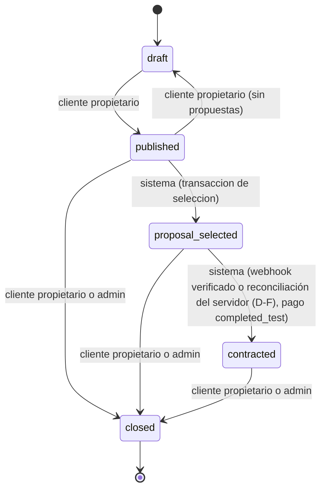
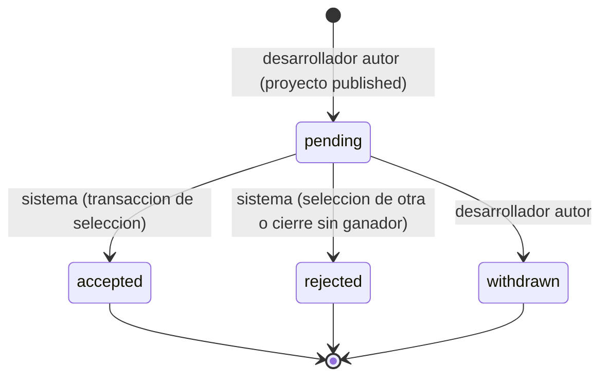
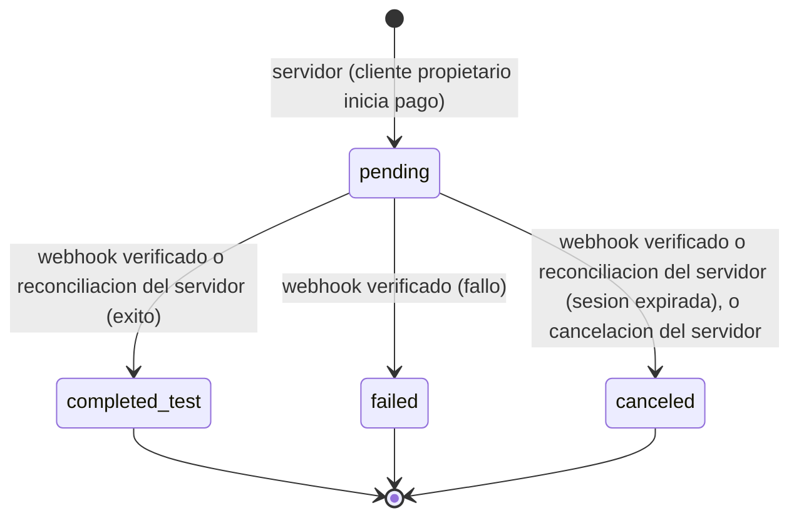
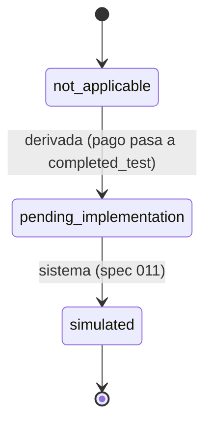
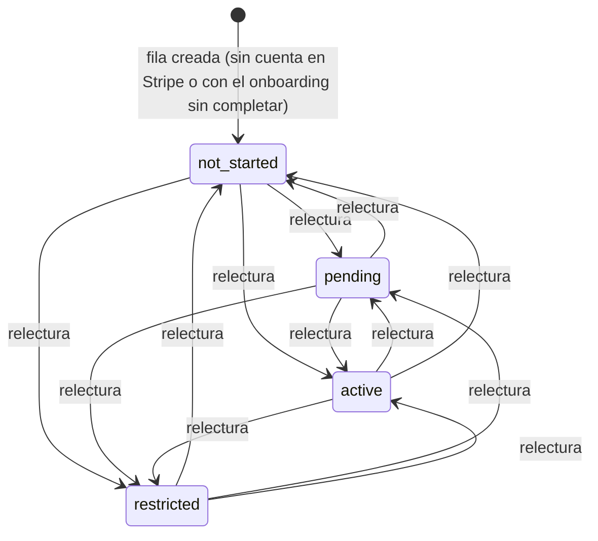

# Máquinas de estado

Define las 4 máquinas de estado de Nexora: proyecto, propuesta, intento de pago y transferencia. Los identificadores de estado son canónicos (inglés, snake_case) y la columna "Etiqueta" es el texto de UI aprobado. Origen normativo: `docs/specs/002-product-domain-and-architecture.md` (RF4 y sección 9). `system-design.md §5` solo resume y enlaza este documento.

Reglas transversales:

- Ninguna transición a `completed_test` (pago) ni a `contracted` (proyecto) la dispara la página de retorno del navegador ni una acción del cliente. Ambas dependen de un webhook de Stripe verificado en servidor (firma válida) o de una lectura autenticada de la sesión hecha por el servidor (botón «Actualizar estado», 010 D-F).
- Todo estado de pago es de Test Mode (`livemode=false`) y nunca se presenta como dinero real.
- Las transiciones entre módulos se hacen mediante funciones de transición expuestas por el módulo dueño, nunca por SQL directo desde otro módulo.

---

## 1. Proyecto (`project.status`)

| Id | Etiqueta |
|---|---|
| `draft` | Borrador |
| `published` | Publicado |
| `proposal_selected` | Con propuesta seleccionada · pendiente de pago |
| `contracted` | En contratación |
| `closed` | Cerrado |

| Transición | Quién la dispara | Condición |
|---|---|---|
| `draft -> published` | Cliente propietario | Datos del proyecto válidos (spec 005) |
| `published -> draft` | Cliente propietario | Solo si no tiene propuestas (D3) |
| `published -> proposal_selected` | Sistema, dentro de la transacción de selección iniciada por el cliente propietario | El proyecto sigue en `published`; la propuesta seleccionada está en `pending` |
| `proposal_selected -> contracted` | Sistema, tras procesar un webhook verificado o una reconciliación del servidor (D-F) que deja el pago en `completed_test` | Intento de pago asociado a la propuesta ganadora. Nunca por el navegador ni por acción del cliente |
| `published -> closed` | Cliente propietario (o administrador) | Cierre manual; las propuestas `pending` pasan a `rejected` |
| `proposal_selected -> closed` | Cliente propietario (o administrador) | Cancelación antes de pagar; solo mientras no exista pago `completed_test`. Con un intento `pending`, se cancela o se espera su resolución (D2; detalle en specs 010/012) |
| `contracted -> closed` | Cliente propietario (o administrador) | Cierre manual tras la contratación |

Estado terminal: `closed`.

Notas:

- `draft` no pasa a `closed` en el MVP: un borrador se edita o se descarta (el borrado queda para la spec 005).
- Solo `published` admite nuevas propuestas.
- No se reabre la selección (`proposal_selected -> published`) en el MVP (D2).

---

## 2. Propuesta (`proposal.status`)

| Id | Etiqueta |
|---|---|
| `pending` | Pendiente |
| `accepted` | Aceptada |
| `rejected` | Rechazada |
| `withdrawn` | Retirada |

| Transición | Quién la dispara | Condición |
|---|---|---|
| (creación) -> `pending` | Desarrollador autor | Proyecto en `published`; usuario con rol `developer`; no es el propietario del proyecto; máximo una propuesta por desarrollador por proyecto (D5) |
| `pending -> accepted` | Sistema, dentro de la transacción de selección (acción del cliente propietario) | Exactamente una por proyecto |
| `pending -> rejected` | Sistema, en la misma transacción de selección para las demás; o al cerrarse el proyecto sin ganador | Proyecto cerrado o con otra propuesta seleccionada |
| `pending -> withdrawn` | Desarrollador autor | Solo mientras el proyecto está `published` |

Estados terminales: `accepted`, `rejected`, `withdrawn`. Una propuesta `accepted` no se retira en el MVP.

---

## 3. Intento de pago (`paymentAttempt.status`)

La ausencia de intento equivale a "No iniciado" (no es un estado almacenado).

| Id | Etiqueta |
|---|---|
| `pending` | Pendiente |
| `completed_test` | Completado en Test Mode |
| `failed` | Fallido |
| `canceled` | Cancelado |

| Transición | Quién la dispara | Condición |
|---|---|---|
| (creación) -> `pending` | Servidor, al pedir el cliente propietario iniciar el pago | Proyecto en `proposal_selected`; no existe otro intento `pending`/`completed_test` para el proyecto. Importe y moneda salen de la propuesta ganadora guardada en servidor |
| `pending -> completed_test` | Webhook de Stripe verificado (firma válida) o reconciliación del servidor (D-F) | Evento de éxito o sesión pagada leída de la API. La página de retorno nunca dispara esta transición |
| `pending -> failed` | Webhook de Stripe verificado | Evento de fallo de pago |
| `pending -> canceled` | Webhook de Stripe verificado o reconciliación del servidor (D-F) (sesión expirada) o cancelación explícita del servidor al abandonar la sesión | La redirección de cancelación del navegador solo informa; no cambia el estado por sí sola |

Estados terminales: `completed_test`, `failed`, `canceled`.

Nota: la reconciliación del servidor (botón «Actualizar estado», 010 D-F) solo produce `completed_test` o `canceled`; nunca `failed`, que solo llega por el evento `checkout.session.async_payment_failed`.

Reglas:

- Un reintento crea un intento nuevo.
- Un evento tardío o repetido nunca revierte `completed_test` ni reabre un estado terminal.
- Mapeo de eventos (spec 010):
  - `checkout.session.completed` y `checkout.session.async_payment_succeeded` con `payment_status = 'paid'`: `pending -> completed_test` y `proposal_selected -> contracted`. Con `completed` y `payment_status` distinto de `paid` (método asíncrono) no cambia nada hasta el evento asíncrono.
  - `checkout.session.async_payment_failed`: `pending -> failed`; el proyecto sigue en `proposal_selected`.
  - `checkout.session.expired`: `pending -> canceled`; el proyecto sigue en `proposal_selected`.
  - Intento no `pending`, no encontrado o con importe/moneda distintos: se ignora sin cambios. `payment_intent.payment_failed` y cualquier otro evento no se manejan: un rechazo de tarjeta no termina la sesión, así que no produce `failed`.
  - La reconciliación "Actualizar estado" lee la sesión en la API de Stripe y aplica las mismas reglas.

---

## 4. Transferencia al desarrollador (`transferStatus`)

La transferencia es independiente del pago: son estados y entidades distintos. Que el pago esté en `completed_test` no implica que el desarrollador haya recibido nada.

| Id | Etiqueta | Cuándo |
|---|---|---|
| `not_applicable` | No aplicable | Derivado: no existe pago `completed_test` para el proyecto. No se almacena |
| `pending_implementation` | Pendiente de implementación | Derivado en el MVP inicial: existe pago `completed_test` y Stripe Connect aún no está implementado |
| `simulated` | Simulada | Solo si la spec 011 incorpora Connect en test mode o simulación almacenada |

| Transición | Quién la dispara | Condición |
|---|---|---|
| `not_applicable -> pending_implementation` | Derivada automáticamente al pasar el pago a `completed_test` | Sin acción de usuario |
| `pending_implementation -> simulated` | Sistema (spec 011, última fase) | Pago `completed_test`; flujo de test aprobado |

Reglas:

- Hasta la spec 011 no existe la tabla `simulatedTransfer`; el estado se deriva del pago (D6).
- `pending_implementation` y `simulated` nunca se muestran como dinero recibido por el desarrollador.
- `simulated` es el estado final de esta máquina en el alcance actual.
- Nota (spec 011a): 011a crea la cuenta de destino (ver §6); la transferencia y su máquina de estados formal llegan con 011b.

---

## 5. Casos límite

- Dos selecciones simultáneas del mismo proyecto: solo una gana; la otra recibe error de conflicto (máximo una selección por proyecto).
- Retirada de propuesta concurrente con la selección de esa propuesta: gana la que se confirma primero; la otra falla sin dejar estado inconsistente.
- Webhook repetido: no cambia el estado (idempotencia por `processedPaymentEvent`).
- Webhook fuera de orden (por ejemplo `canceled` o `failed` tras `completed_test`): se ignora la regresión.
- Pago `failed` o `canceled`: el proyecto permanece en `proposal_selected` y puede crearse un nuevo intento.
- Retorno del navegador a la URL de éxito antes del webhook: la UI muestra "verificando"; no se afirma pago completado.
- Evento de pago confirmado cuando el proyecto ya no está en `proposal_selected` (p. ej. `closed`; solo por cierre forzado fuera de la app): el intento pasa a `completed_test`, el proyecto no cambia (ni se contrata ni se reabre), se registra una anomalía en el log y no se muestra como contratación (spec 010 RF6).
- Cliente intenta cerrar un proyecto con pago `pending`: se rechaza con `PAYMENT_IN_PROGRESS`. El intento se resuelve por `checkout.session.expired` (`canceled`) o por "Actualizar estado" (spec 010); la cancelación explícita del cliente llega con la spec 012 (D2).
- Usuario sin fila interna aunque exista en Clerk (primer ingreso, sincronización pendiente): spec 004.
- Casos límite de la cuenta conectada: ver §6.

---

## 6. Cuenta conectada (`connectedAccount.status`)

Spec 011a. Cuenta de Stripe Connect del desarrollador, solo en modo de prueba. El estado almacenado es una **caché derivada** de Stripe, no una máquina de negocio: no hay transiciones prohibidas. La ausencia de cuenta en Stripe (`stripe_account_id` nulo) equivale a `not_started`.

| Id | Etiqueta |
|---|---|
| `not_started` | Sin configurar |
| `pending` | En revisión por Stripe |
| `active` | Lista para recibir transferencias de prueba |
| `restricted` | Requiere acción |

Cualquier estado puede pasar a cualquier otro cuando el servidor relee la cuenta (retorno del onboarding, enlace caducado o botón "Actualizar estado"). `not_started` es el inicial.

### Derivación (reglas en orden de precedencia)

| # | Condición (datos de Stripe) | Estado |
|---|---|---|
| 1 | Capacidad `transfers` = `active` | `active` (aunque haya requisitos futuros o `payouts_enabled = false`) |
| 2 | `details_submitted` es falso | `not_started` |
| 3 | `past_due` o `currently_due` no vacíos, o `disabled_reason` no nulo y distinto de `requirements.pending_verification` y `under_review` | `restricted` (incluye `rejected.*`, `requirements.past_due`, `action_required.*`, `listed`, `platform_paused`, `other`) |
| 4 | Cualquier otro caso | `pending` (datos enviados, Stripe verificando, o capacidad `pending`/`inactive` sin requisitos) |

### Casos límite

- Doble clic o dos pestañas en "Configurar": una sola fila (`user_id` único) y una sola cuenta en Stripe (clave de idempotencia por fila).
- Fallo de red tras crear la cuenta en Stripe: la fila queda sin cuenta; el reintento con la misma clave devuelve la misma cuenta.
- Connect sin activar en la plataforma, clave live o ausente, o `APP_URL` ausente: el servidor responde que los cobros de prueba no están disponibles y no escribe.
- Enlace de onboarding caducado o reutilizado: Stripe redirige a la URL de refresh, que genera un enlace nuevo.
- El desarrollador vuelve sin completar: el retorno relee y queda `not_started` con cuenta ("Continuar configuración").
- Requisitos nuevos tras estar `active`: sigue `active` mientras `transfers` esté activa; si Stripe la desactiva, pasa a `restricted` en la siguiente lectura.
- Cuenta borrada en Stripe o clave de otra cuenta de plataforma: error `ACCOUNT_UNAVAILABLE` sin escribir; reseteo manual de la fila (solo modo de prueba).
- Estado desfasado: sin `account.updated` (diferido), un cambio de Stripe posterior solo se refleja al releer. 011b no debe fiarse de la caché sin decidir si relee antes de transferir.
- `?onboarding=returned` escrito a mano solo muestra un aviso; el estado sale siempre de la base de datos.
