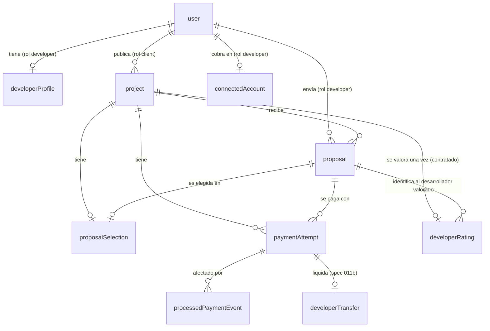

# Diseño del sistema de Nexora

Origen normativo: `docs/specs/002-product-domain-and-architecture.md` (aprobada). Los nombres de tablas y columnas finales los fija la spec 003. Cita las secciones como `system-design.md §N`. Cada sección es autocontenida: lee solo la que necesites.

---

## 1. Visión y principios

Nexora es un marketplace donde un cliente publica un proyecto, los desarrolladores envían propuestas, el cliente selecciona una y realiza un pago de prueba (Stripe Test Mode). Requisitos completos en `docs/BRIEF.md`; las reglas de negocio están en `BRIEF §7` (se enlazan, no se copian aquí).

Principios (resumen de `BRIEF §12`):

- Claridad en los estados y responsabilidades.
- Seguridad desde el diseño.
- Una sola propuesta ganadora por proyecto.
- Separación entre aceptación, pago confirmado y transferencia al desarrollador.
- No presentar operaciones de prueba como transacciones reales.
- MVP enfocado en el marketplace principal (YAGNI).

Traducción de las reglas de `BRIEF §7` a dominio:

| Regla BRIEF §7 | Traducción de dominio |
|---|---|
| 1, 3, 6 | `project.status = published` es la única condición que admite propuestas |
| 4, 5, 7 | `proposalSelection` 1:1 con proyecto; selección transaccional; solo el cliente propietario |
| 8 | Acceso a proyecto/propuesta/pago privados solo por propietario, autor o administrador (matriz en §6) |
| 9, 10, 11, 12 | El estado de pago solo cambia por webhook verificado o por lectura autenticada de la API de Stripe hecha por el servidor (botón «Actualizar estado», spec 010 D-F); idempotencia vía `processedPaymentEvent`; `failed`/`canceled` nunca pasan a `completed_test` |
| 13, 14, 15 | `livemode=false` siempre; transferencia independiente del pago; sin comisiones |

---

## 2. Entidades y relaciones

Todas viven en Neon salvo indicación. Los nombres son conceptuales.

| Entidad | Propósito | Campos de negocio | Relaciones |
|---|---|---|---|
| Usuario (`user`) | Identidad interna vinculada a Clerk | `clerkUserId` (único), rol, nombre visible, email, fechas | 1 usuario : N proyectos (si cliente); 1 : N propuestas (si desarrollador); 1 : 0..1 perfil de desarrollador |
| Rol | Atributo del usuario, no entidad aparte | `client` \| `developer` \| `admin` | Un solo rol por usuario (D1) |
| Perfil del desarrollador (`developerProfile`) | Información pública/básica del desarrollador | titular, ubicación, disponibilidad, bio (texto plano), enlaces (hasta 5, solo https), correo de contacto opcional y su visibilidad (`accepted_client` por defecto, `any_client`, `nobody`); `technologies` y `external_url` quedan sin uso (spec 019) | 1:1 con usuario (rol `developer`) |
| Proyecto (`project`) | Necesidad publicada por un cliente | título, categoría, descripción, presupuesto mín/máx USD, plazo en semanas, tecnologías (tags del catálogo), estado | N:1 cliente (usuario); 1:N propuestas; 0..1 selección; 0..N intentos de pago; N:M tecnologías |
| Tecnología (`technology`) | Tag del catálogo cerrado y compartido (lenguajes, frameworks, bases de datos, etc., más «Otros») | `slug` (único), nombre (único sin distinguir mayúsculas), orden | N:M con proyecto (tabla puente `project_technologies`) |
| Propuesta (`proposal`) | Oferta de un desarrollador a un proyecto | precio USD, plazo en semanas, descripción de la solución, estado | N:1 proyecto; N:1 desarrollador (usuario); como máximo una propuesta por desarrollador y proyecto (D5) |
| Selección de propuesta (`proposalSelection`) | Hecho inmutable "este proyecto eligió esta propuesta" | proyecto, propuesta, cliente que seleccionó, fecha | 1:1 con proyecto y 1:1 con propuesta; como máximo un ganador por proyecto |
| Intento de pago (`paymentAttempt`) | Un intento de pago en Stripe Checkout (test) | proyecto, propuesta ganadora, cliente, importe USD y moneda copiados de la propuesta en el servidor, id de Checkout Session, id de PaymentIntent (cuando exista), estado, `livemode=false` | N:1 proyecto; N:1 propuesta; como máximo un intento `pending` o `completed_test` por proyecto |
| Evento de pago procesado (`processedPaymentEvent`) | Registro para idempotencia de webhooks | `stripeEventId` (único), tipo, fecha de recepción, resultado del procesamiento | referencia opcional al intento de pago afectado |
| Transferencia al desarrollador (`developerTransfer`, tabla `developer_transfers`) | Transferencia de prueba al desarrollador ganador, distinta del pago (spec 011b) | intento de pago (único), desarrollador destino, importe y moneda copiados del intento, estado (`pending` \| `completed_test` \| `failed`), id de transferencia de Stripe (nulo hasta crearla), generación de reintento, contador y fecha de intentos, código de motivo propio, fecha de completado | 1:1 con intento de pago `completed_test` (nace en la misma transacción que el pago); N:1 desarrollador. Reemplaza a `simulatedTransfer` (D6 cumplida) |
| Cuenta conectada (`connectedAccount`) | Cuenta de Stripe Connect del desarrollador, solo modo de prueba (spec 011a) | usuario, id de cuenta de Stripe (único, nulo hasta que Stripe la crea), estado derivado (`not_started` \| `pending` \| `active` \| `restricted`), fecha de última sincronización | 1:0..1 con usuario de rol `developer`. Destino de la transferencia de 011b |
| Valoración del desarrollador (`developerRating`) | Valoración del cliente al desarrollador contratado (spec 020) | proyecto (único), propuesta aceptada, estrellas 1 a 5, comentario opcional (<= 600, texto plano), fechas | 1:0..1 con proyecto; la propuesta aceptada da el desarrollador (no se guarda `developer_id` ni `client_id`) |

### Diagrama



### Invariantes de dominio

- I1. Máximo una selección por proyecto y una propuesta seleccionada por proyecto.
- I2. Importe y moneda de un intento de pago salen siempre de la propuesta ganadora guardada en servidor, nunca del cliente.
- I3. El pago (`paymentAttempt`) y la transferencia son entidades y estados independientes.
- I4. Ningún estado de pago `completed_test` se alcanza sin un evento de Stripe verificado en servidor.
- I5. Todo dato de pago en este alcance es de Test Mode y nunca se presenta como dinero real.

---

## 3. Propiedad de datos: Neon / Clerk / Stripe / Supabase Storage

Nexora no almacena credenciales, contraseñas ni datos de tarjeta. Cada categoría de dato tiene una única fuente de verdad.

| Dato | Fuente de verdad | Notas |
|---|---|---|
| Credenciales, contraseña, sesión, verificación de email, proveedores OAuth | Clerk | Nexora nunca los almacena |
| Identificador de identidad (`clerkUserId`) | Clerk | Copia en Neon como clave de vinculación única |
| Email y nombre visible | Clerk | Copia en Neon para listados y relaciones; la spec 004 define la sincronización; mínima exposición de datos personales |
| Rol de negocio | Neon (`user.role`) | Fuente de verdad de autorización. Puede reflejarse en metadata de Clerk solo como caché (D1) |
| Perfil del desarrollador, proyectos, propuestas, selecciones | Neon | Datos de dominio. Del perfil, solo lo que publica el desarrollador; el nombre visible y el email de acceso siguen en Clerk/`users` y el correo de acceso nunca se expone (spec 019) |
| Intentos de pago: estado, importe, relaciones con proyecto/propuesta | Neon | El estado local solo cambia por webhook verificado o lectura autenticada del servidor (010 D-F) |
| Checkout Session, PaymentIntent, Event, instrumentos de pago, datos de tarjeta | Stripe | Neon guarda solo identificadores externos (únicos) y estado derivado. Nunca datos de tarjeta |
| Eventos de webhook procesados | Neon (`processedPaymentEvent`) | Copia del `event.id` para idempotencia |
| Archivos privados | Supabase Storage | MVP sin archivos; reservado. Acceso solo por URLs firmadas desde servidor (spec 015); Neon guardaría solo la ruta del objeto |
| Cuenta conectada del desarrollador (Stripe Connect) | Stripe (fuente de verdad: datos personales, requisitos, capacidades) | Neon guarda solo el `stripe_account_id` único y el estado derivado como caché (spec 011a). Nunca requisitos, email, país ni nombre |
| Valoraciones | Neon | Tabla `developer_ratings` (spec 020). El nombre del cliente no se guarda: se abrevia en servidor al leer desde `users` |

---

## 4. Estructura de módulos y dependencias permitidas

Solo se crean las subcarpetas que cada spec de implementación necesite (YAGNI, `SETUP.md §1.5`).

```
src/
  modules/
    auth/        -> integración Clerk: resolver usuario actual y rol, guards de servidor (spec 004)
    users/       -> usuario interno + perfil del desarrollador (servicios, schemas, tipos)
    projects/    -> proyectos y su ciclo de vida (specs 005-006)
    proposals/   -> propuestas y selección de propuesta (specs 007-008)
    payments/    -> intentos de pago, eventos procesados, cuentas conectadas, transferencia (specs 009-011)
    profile/     -> edición y vista pública del perfil del desarrollador, privacidad del correo de contacto (spec 019)
    ratings/     -> valoraciones del cliente al desarrollador contratado (spec 020)
    dashboard/   -> panel de resumen del cliente y del desarrollador, solo lectura (specs 012 y 013)
  lib/
    db/          -> cliente Drizzle y schema (ubicación final: spec 003, D7)
  app/
    api/webhooks/stripe/route.ts   -> solo routing; delega a modules/payments (spec 010)
```

Dependencias permitidas (sin ciclos):

| Módulo | Puede depender de |
|---|---|
| `auth` | `users` (resuelve el usuario interno; spec 004, D-A) |
| `users` | (sin dependencias de otros módulos; nunca importa `auth`) |
| `projects` | `users`, `auth` |
| `proposals` | `projects`, `users`, `auth` |
| `payments` | `projects`, `proposals`, `users`, `auth` |
| `profile` | `users`, `projects`, `proposals`, `auth` (nadie depende de `profile` salvo `src/app`) |
| `ratings` | `projects`, `proposals`, `users`, `auth` (lectura de sus tablas Drizzle); más una dependencia de **solo tipo** hacia `profile` (`DeveloperRatingSummary`), sin ciclo porque `profile` no importa `ratings` (spec 020) |
| `dashboard` | `auth` y lectura de las tablas Drizzle de `projects`, `proposals`, `payments`, `ratings` y `users` (no sus servicios, con una excepción: `getConnectedAccountOverview` y `getDeveloperRatingSummary`, solo lectura y sin Stripe, spec 013; solo lectura, sin Stripe). Nadie depende de `dashboard` salvo `src/app`; `payments` -> `dashboard` ausente (spec 012) |

Reglas:

- Excepción acotada `projects` <-> `proposals` (spec 005 D-B, reescrita por spec 007 D-E/D-H):
  - Escritura: `projects` solo puede invocar funciones hoja de `proposals/services/proposal-transitions.ts` (p. ej. `rejectPendingProposals`, que `closeProject` llama dentro de su transacción al cerrar desde `published`). Ya no hace SQL de escritura sobre `proposals`. Esa función recibe el `tx`, no importa `db` ni `projects`.
  - Lectura: `projects` conserva la lectura de las tablas Drizzle `proposals` y `payments` (no sus servicios) para contar propuestas (D3) y comprobar intentos de pago (D2).
  - UI (spec 007 D-H): `projects/components/proposal-cta.tsx` importa `DeveloperProposalSection` de `proposals/components` (punto de extensión reservado por la spec 006). Es un import de UI `projects` -> `proposals`.
  - `proposals` nunca importa `project.service`; solo las tablas de `projects`.
  - Pagos (spec 009): `payments` escribe únicamente en `payment_attempts` y `processed_payment_events` (esta última desde 010) y solo lee las tablas Drizzle de `projects`, `proposals` y `users`; no importa sus servicios. El cliente de Stripe es el singleton `src/lib/stripe.ts` (solo servidor, rechaza claves live) y la lógica de negocio solo lo importa desde `@/lib/stripe`.
- Cuentas conectadas (spec 011a): `payments` escribe además `connected_accounts`. Solo lee `users` para el usuario actual y la cuenta se resuelve siempre por la sesión, nunca por un id del cliente.
- Selección (spec 008): `proposals/services/proposal-selection.service.ts` escribe en `projects` solo mediante `projects/services/project-transitions.ts` (hoja que recibe el `tx`, no importa `db`, `project.service` ni nada de `proposals`); `projects` sigue sin importar servicios de `proposals`.
- La selección de propuesta es una operación transaccional que escribe en `proposals` y `projects`. Vive en `proposals` (servicio de selección) y usa una función de transición expuesta por `projects` (detalle en spec 008).
- La transición `proposal_selected -> contracted` la ejecuta el servicio de `payments` llamando a la hoja `markContracted` de `projects/services/project-transitions.ts` (spec 010), nunca por SQL directo desde otro módulo.
- `src/app` es solo routing. Los clientes de Clerk, Stripe y Supabase son singletons mínimos en `src/lib`; la lógica de negocio vive en los módulos.
- El módulo `users` agrupa el usuario y la tabla `developer_profiles` (D4); la lógica del perfil (servicios, action, schemas y componentes) vive en el módulo `profile` (spec 019, D14). `profile` lee las tablas Drizzle de `proposals` y `projects` (regla `accepted_client` del correo de contacto), sin importar sus servicios. Excepción acotada: `profile` escribe en `developer_profiles` solo con `INSERT ... ON CONFLICT (user_id) DO UPDATE` y el `user_id` sale siempre de la sesión. `users` no cambia de dependencias.

---

## 5. Estados y transiciones

Resumen. El detalle (transiciones, disparadores, condiciones, diagramas y casos límite) vive en [`state-machines.md`](./state-machines.md). Los identificadores son canónicos (snake_case, inglés) y no admiten sinónimos.

### 5.1 Proyecto (`project.status`)

`draft`, `published`, `proposal_selected`, `contracted`, `closed` (terminal). Solo `published` admite propuestas. `contracted` solo se alcanza tras un webhook verificado (o una reconciliación autenticada del servidor, 010 D-F) que deja el pago en `completed_test`.

### 5.2 Propuesta (`proposal.status`)

`pending`, `accepted`, `rejected`, `withdrawn`. Los tres últimos son terminales. Exactamente una propuesta `accepted` por proyecto, vía la transacción de selección.

### 5.3 Intento de pago (`paymentAttempt.status`)

`pending`, `completed_test`, `failed`, `canceled`. Los tres últimos son terminales; un reintento crea un intento nuevo. La ausencia de intento equivale a "No iniciado" (no se almacena). Solo un webhook verificado o una lectura autenticada del servidor (§7) cambia el estado.

### 5.4 Transferencia (`transferStatus`)

`pending`, `completed_test`, `failed` (spec 011b; se almacena en `developer_transfers`). `completed_test` es terminal; `failed` se reabre solo por reintento manual del desarrollador. Independiente del pago (I3); la ausencia de fila equivale a "sin transferencia". Nunca se muestra como dinero recibido: siempre "Transferencia de prueba, no es dinero real". Detalle en `state-machines.md §4`.

### 5.5 Cuenta conectada (`connectedAccount.status`)

`not_started`, `pending`, `active`, `restricted`. Es una caché derivada de Stripe (spec 011a): cualquier estado puede pasar a cualquier otro al releer la cuenta. Desde 011c se deriva de Accounts v2. `active` significa que la capacidad `stripe_balance.stripe_transfers` de la configuración `recipient` está activa; no mueve dinero por sí sola. La ausencia de fila equivale a "Sin configurar". Derivación y casos límite en `state-machines.md §6`.

---

## 6. Roles y permisos

Matriz de alto nivel derivada de `BRIEF §4`. El enforcement (guards, middleware, sincronización) es la spec 004.

| Acción | Visitante | Cliente | Desarrollador | Administrador |
|---|---|---|---|---|
| Ver catálogo y detalle de proyectos `published` | sí | sí | sí | sí |
| Crear/editar/publicar/cerrar proyecto propio | no | sí | no | cierre/soporte |
| Ver propuestas de un proyecto | no | solo de proyectos propios | solo las propias | sí (lectura) |
| Enviar/retirar propuesta | no | no | sí (proyecto `published`) | no |
| Seleccionar propuesta | no | solo en proyecto propio | no | no |
| Iniciar pago de prueba | no | solo en proyecto propio con propuesta seleccionada | no | no |
| Ver estado de pago | no | proyectos propios | su propuesta ganadora | sí (lectura) |
| Configurar cobros de prueba (cuenta conectada propia; acción `payout.manage`) | no | no | sí, solo la propia | no |
| Reintentar transferencias de prueba propias (acción `transfer.retry`; lectura con `payout.manage`) | no | no | sí, solo las propias | no |
| Editar perfil propio (acción `profile.edit`) | no | no | sí, solo el propio | no |
| Valorar al desarrollador (acción `rating.create`) | no | solo cliente propietario de un proyecto contratado (una vez; editable 14 días) | no | no |
| Ver perfil público de un desarrollador | sí | sí | sí | sí (el correo de contacto solo lo ve un cliente según la visibilidad elegida: por defecto, uno con propuesta aceptada del desarrollador; nunca visitante, desarrollador ni admin) |

Notas:

- Un solo rol por usuario (`client` | `developer` | `admin`), fijado al registrarse (D1). Un cliente no puede enviar propuestas a su propio proyecto.
- El rol de administrador se asigna fuera de la app (manualmente). D8 confirmada en la spec 004: el administrador lee proyectos, propuestas y pagos y puede cerrar proyectos; no modera, no edita contenido ajeno, no inicia pagos, no selecciona propuestas y no cambia roles desde la app (ver `docs/specs/004-authentication-and-authorization.md`, RF7 y R3).
- La información de contacto privada solo es visible según permisos (`BRIEF §6.6`); la spec 013 define qué datos ve el desarrollador ganador.

---

## 7. Pagos y webhooks: principios

- **Test Mode siempre.** Todo pago es de prueba (`livemode=false`) y nunca se presenta como dinero real (I5).
- **Importe desde el servidor.** Importe y moneda se toman de la propuesta ganadora guardada en servidor, nunca del navegador (I2).
- **Verificación de firma.** Todo evento de Stripe se acepta solo con firma válida verificada en servidor.
- **El navegador no es fuente de verdad.** Las páginas de retorno (éxito o cancelación) solo informan; nunca cambian el estado del pago ni del proyecto. Si el navegador vuelve antes del webhook, la UI muestra "verificando" y no afirma pago completado.
- **Solo un evento verificado o una lectura autenticada del servidor transiciona.** `pending -> completed_test|failed|canceled` y `proposal_selected -> contracted` dependen de un webhook verificado por firma o de una lectura autenticada de la sesión en la API de Stripe hecha por el servidor (botón "Actualizar estado", spec 010 D-F, que aplica el mismo núcleo de reglas); el navegador nunca aporta estado (I4).
- **Eventos manejados (spec 010).** Solo `checkout.session.completed`, `checkout.session.expired`, `checkout.session.async_payment_succeeded` y `checkout.session.async_payment_failed`. `payment_intent.payment_failed` no se maneja (D-B): un rechazo de tarjeta no termina la sesión de Checkout, por lo que `failed` solo se alcanza con el fallo definitivo de un método asíncrono.
- **Idempotencia.** Cada `event.id` se registra en `processedPaymentEvent` (único); un evento repetido no cambia estado.
- **Sin regresiones.** Un evento tardío o fuera de orden nunca revierte `completed_test` ni reabre un estado terminal.
- **Pago y transferencia separados** (I3). Sin comisiones.
- **Sin datos sensibles.** Nunca se guardan datos de tarjeta; solo identificadores externos únicos y estado derivado.
- La ruta de webhook (`src/app/api/webhooks/stripe/route.ts`) solo hace routing y delega a `modules/payments`. Contratos detallados en las specs 009-010; Stripe Connect en la 011.
- **Connect solo en modo de prueba (spec 011a).** Las cuentas conectadas usan el mismo cliente `getStripe()`, que rechaza claves live, y desde 011c se crean con Accounts v2 (`stripe.v2.core.accounts`, Account Links v2); la opción de compatibilidad con Accounts v1 del Dashboard ya no es necesaria. Requiere activar Connect en el Dashboard de Stripe en modo de prueba (precondición manual).
- **Separate charges and transfers.** El Checkout sigue cobrando en la cuenta de plataforma; la transferencia al desarrollador es posterior e independiente (011b).
- **Transferencia de prueba (spec 011b).** Al pasar el pago a `completed_test` (webhook verificado o reconciliación), `applySessionOutcome` inserta en la misma transacción una fila `developer_transfers` `pending`. Después del commit, `runTransferForAttempt` (nunca lanza) relee la cuenta conectada, lee el PaymentIntent y llama a `stripe.transfers.create` (importe completo de la BD, USD, sin comisión, `source_transaction`, clave `nexora:transfer:<id>:<generación>`). Nunca hay llamadas a Stripe dentro de una transacción, y una falla de la transferencia nunca hace fallar el webhook. Los motivos se guardan como códigos propios; los mensajes de Stripe solo van a logs saneados. Reintento sin cron: tras el pago, al volver del onboarding o al "Actualizar estado" con cuenta `active`, y manual del desarrollador.
- **Sincronización por relectura.** El estado de la cuenta conectada se actualiza leyendo la cuenta servidor a servidor al volver del onboarding y con el botón "Actualizar estado". El webhook `account.updated` queda diferido; el endpoint de 010 no recibe eventos de cuentas conectadas.

---

## 8. Decisiones registradas

### Confirmadas

- Stack de `BRIEF §9`: Clerk, Drizzle ORM + Neon Postgres, Supabase Storage, Stripe, Zod.
- Stripe Connect en test mode como último paso (spec 011) (la transferencia ya se registra y ejecuta desde 011b). La spec 011 se parte en 011a (cuenta conectada y onboarding del desarrollador, sin mover dinero) y 011b (registro y ejecución de la transferencia).
- Prefijo `NNN-slug.md` para specs en `docs/specs/`.
- Esta arquitectura se documenta en `docs/architecture/` y se referencia desde `SETUP.md §4`.

### D1-D11 (aprobadas con la propuesta por defecto)

| Id | Decisión | Spec destino |
|---|---|---|
| D1 | Un solo rol por usuario (`client` \| `developer` \| `admin`), elegido al registrarse y no modificable en el MVP; fuente de verdad `user.role` en Neon, con caché opcional en metadata de Clerk | 003, 004 |
| D2 | `proposal_selected -> closed` permitido mientras no exista pago `completed_test`; con intento `pending` hay que cancelarlo o esperar su resolución. No se reabre la selección en el MVP. Cierre del lado servidor en 010: el evento `checkout.session.expired` y la reconciliación "Actualizar estado" cancelan el intento `pending`; la cancelación explícita del cliente llega en 012 (**resuelta**: `cancelPendingPayment`, solo con `expired` confirmado por Stripe; ver 012-D-A a D-M) | 010, 012 |
| D3 | `published -> draft` solo si el proyecto no tiene propuestas | 005 |
| D4 | Tabla del perfil del desarrollador dentro del módulo `users`; la lógica de perfil vive en el módulo `profile` (ajustada por 019 D14) | 003, 019 |
| D5 | Una propuesta por desarrollador por proyecto (unicidad); editable mientras `pending`; no se permite reenviar tras retirar | 003, 007 |
| D6 | No se crea `simulatedTransfer` hasta la spec 011; antes `transferStatus` se deriva del pago. **Cumplida en 011b:** la tabla `developer_transfers` reemplaza a `simulatedTransfer` | 011 |
| D7 | Ubicación del cliente Drizzle y schema: se reserva `src/lib/db`; decisión final en la spec 003 | 003 |
| D8 | Admin: lectura de proyectos/propuestas/pagos y cierre de proyectos; sin moderación | 004 |
| D9 | Solo USD en el MVP, moneda almacenada con el importe; decimales/centavos se deciden en la spec 003 | 003 |
| D10 | Convención de variables de entorno y `.env.example`: **resuelta para las variables de Stripe en la spec 009** (nombres `UPPER_SNAKE`, secretos nunca con `NEXT_PUBLIC_`, `.env.example` solo con nombres agrupados por proveedor, `.env.local` nunca se commitea). `STRIPE_SECRET_KEY` y `APP_URL` son solo de servidor; `STRIPE_WEBHOOK_SECRET` llega con la spec 010. El valor por entorno queda para la 017 | 009, 017 |
| D11 | Tecnologías de un proyecto como **catálogo cerrado** en BD (`technologies`) con relación N:M (`project_technologies`), en lugar de texto libre; se identifican por `slug` en formularios y URL, mínimo 1 y máximo 10 por proyecto. «Otros» es solo una etiqueta (sin texto asociado). El alta de tags se hace por migración. `developer_profiles.technologies` queda fuera de alcance (texto libre) | 009c |

### D12-D14 (spec 011a, aprobadas)

| Id | Decisión | Spec destino |
|---|---|---|
| D12 | Modelo Separate charges and transfers con disparo automático de la transferencia al confirmarse el pago (`pending -> completed_test`) y por el importe completo de la propuesta, sin comisión. El Checkout de 009 no cambia; `transfer_group` va en 011b | 011b |
| D13 | Cuenta conectada con Accounts v1 usando `controller` (equivalente a Express, sin el `type` obsoleto) y onboarding alojado por Stripe con Account Links v1 (`account_onboarding`). Cuentas `US` en USD (país **a verificar**). Alternativa descartada: Accounts v2. **Superada por 011c-D1** (Stripe rechazó Accounts v1 en esta plataforma) | 011a |
| D14 | Estado sincronizado por relectura servidor a servidor (return, refresh y botón "Actualizar estado"); el webhook `account.updated` y `stripe listen --forward-connect-to` quedan diferidos | 011a |

### 011b-D-A a D-I (spec 011b, aprobadas)

Los ids son los de la spec 011b; no sustituyen a los D-x de otras specs.

| Id | Decisión | Spec destino |
|---|---|---|
| 011b-D-A | `source_transaction` (cargo del PaymentIntent) en la transferencia, sin tocar el Checkout de 009; se descarta `transfer_group` en Checkout (cumple la nota de D12/D6 de 011a) | 011b |
| 011b-D-B | La fila de transferencia nace en la misma transacción que el pago (`applySessionOutcome`); una por pago (`UNIQUE payment_attempt_id`); sin llamadas a Stripe en transacciones | 011b |
| 011b-D-C | Clave de idempotencia determinista `nexora:transfer:<transferId>:<retryGeneration>`; solo el reintento manual tras `failed` incrementa la generación | 011b |
| 011b-D-D | Estados `pending`, `completed_test`, `failed`; `failed` solo por rechazo definitivo; lo ambiguo o con precondición no cumplida es `pending` | 011b |
| 011b-D-E | Se relee la cuenta conectada antes de transferir; si no está `active`, la fila queda `pending` / `ACCOUNT_NOT_ACTIVE` | 011b |
| 011b-mejora | El pago no se puede iniciar si el desarrollador ganador no tiene cuenta conectada `active` (`DEVELOPER_PAYOUTS_NOT_READY`); la transferencia `pending` queda para cuentas que dejen de estar activas tras el pago | 011b |
| 011b-mejora-2 | El desarrollador no puede enviar una propuesta sin cuenta conectada `active` (`PAYOUTS_NOT_READY`, `createProposal`). `proposals` importa solo la **tabla** `connected_accounts` de `payments` (lectura); `payments` ya importa tablas de `proposals`: ciclo entre módulos pero sin ciclo de archivos, aceptado en el MVP | 011b |
| 011b-D-F | Reintento automático sin cron (tras el pago, al volver del onboarding o "Actualizar estado" con cuenta `active`) y manual del desarrollador; sin barrido global | 011b |
| 011b-D-G | Pago completado con proyecto no `proposal_selected`: la transferencia se crea igual | 011b |
| 011b-D-H | Ejecución en línea tras el commit (no `after()`); una falla de la transferencia nunca hace fallar el webhook | 011b |
| 011b-D-I | Los motivos se guardan como códigos propios (`last_error_code`), nunca el mensaje ni el código de Stripe | 011b |

### 011c-D1 (spec 011c, aprobada)

| Id | Decisión | Spec destino |
|---|---|---|
| 011c-D1 | Cuenta conectada con Accounts v2 (`POST /v2/core/accounts`) con `configuration.recipient` + `stripe_balance.stripe_transfers`, `dashboard: 'express'` y onboarding con Account Links v2 (`account_onboarding`). Sustituye a D13 por el rechazo de Stripe a Accounts v1 en esta plataforma. El estado se deriva de `stripe_transfers.status` y `requirements.entries` (ver `state-machines.md §6`) | 011c |

### D14-D15 y perfil (spec 019, aprobadas)

Los ids D14 y D15 son los de la spec 019; no sustituyen a los D14 de 011a.

| Id | Decisión | Spec destino |
|---|---|---|
| 019-D14 | Módulo nuevo `profile` (dependencias: `users`, `projects`, `proposals`, `auth`) para la lógica del perfil; la tabla se queda en `users/schema`. Evita que `users` importe `auth`, `proposals` o `projects` (prohibido por §4 y causaría ciclos) | 019 |
| 019-D15 | "Cobros de prueba" pasa a "Mi cuenta": el header del desarrollador muestra "Proyectos", "Mis propuestas" y "Mi cuenta". Esto **reemplaza el enlace de header de 011a D-A**; las rutas `/dashboard/payouts` y sus return/refresh se conservan, con un enlace "Volver a Mi cuenta" | 019 |
| 019-perfil | Avatar por defecto con iniciales (sin subida de foto); tabla `developer_profiles` extendida (no se crea otra); correo de contacto propio con visibilidad `accepted_client` por defecto, resuelta en servidor; biografía en texto plano; perfil público abierto a visitantes anónimos; nombre visible gestionado por Clerk | 019 |

### Valoraciones (spec 020, aprobadas)

Los ids son los de la spec 020; no sustituyen a los D-x de otras specs.

| Id | Decisión | Spec destino |
|---|---|---|
| 020-D-A | Se puede valorar con proyecto contratado (`contracted_at` no nulo; incluye `closed` tras contratar). Ya implica pago `completed_test` | 020 |
| 020-D-B | `unique(project_id)` y FK compuesta `(proposal_id, project_id)`; no se guarda `developer_id` ni `client_id` | 020 |
| 020-D-C/D/E | Sin borrado, moderación, reportes, respuesta del desarrollador ni notificaciones | 020 |
| 020-D-F | Promedio calculado en cada lectura y redondeado a 1 decimal en SQL; `null` sin valoraciones | 020 |
| 020-D-G | Edición durante 14 días desde la creación (336 h), decidida en servidor con reloj inyectable; editar no extiende la ventana | 020 |
| 020-D-H | Nombre del cliente abreviado en servidor ("Maria G."); si no es seguro, "Cliente" | 020 |
| 020-D-I | Columnas `timestamptz`; días restantes calculados en servidor; fechas de la lista en UTC | 020 |
| 020-D-J | Cliente borrado o anonimizado: la valoración se conserva y se muestra como "Cliente" | 020 |
| 020-D-K | Textos de estado, comentario en texto plano, 20 valoraciones sin paginar, perfil visible a anónimos y enlace "Ver valoraciones recibidas" a `/developers/{id}#valoraciones` | 020 |

### Dashboard del cliente y cancelación de pago (spec 012, aprobadas)

Los ids son los de la spec 012; no sustituyen a los D-x de otras specs.

| Id | Decisión | Spec destino |
|---|---|---|
| 012-D-A | Nueva ruta `/dashboard` (resumen); `/dashboard/projects` se queda como está | 012 |
| 012-D-B | El header del cliente pasa a "Mi panel" -> `/dashboard` (modifica 009b) | 012 |
| 012-D-C | Módulo `dashboard` de solo lectura sobre tablas Drizzle; la cancelación vive en `payments` | 012 |
| 012-D-D | `/dashboard` solo para `client`; developer y admin reciben 404 | 012 |
| 012-D-E | Cancelar: Stripe decide; solo `expired` confirmado cancela, vía `applySessionOutcome` | 012 |
| 012-D-F | Carrera cancelar/pagar: árbitro Stripe; si `expire` falla se relee y se aplica el resultado real | 012 |
| 012-D-G | Intento `pending` sin sesión: se cancela solo pasada `RESUME_WINDOW_SECONDS`, con guarda `IS NULL` | 012 |
| 012-D-H | Sin llamadas a Stripe en lecturas del panel | 012 |
| 012-D-I | `closeProject` no cancela solo; la cancelación es una acción explícita | 012 |
| 012-D-J | Botón "Cancelar pago de prueba" en el panel y la página de pago, con `AlertDialog` | 012 |
| 012-D-K | Listas del panel acotadas a 20 con enlace "Ver todos" | 012 |
| 012-D-L | Acciones pendientes derivadas por una función pura (`deriveProjectActions`) | 012 |
| 012-D-M | Aviso de Modo de prueba y transferencia siempre como de prueba, nunca "recibida" | 012 |
| 013-D-A | `/dashboard` es role-aware (misma ruta, vista por rol); `admin` sigue en 404. Resuelve P3 de 012 | 013 |
| 013-D-B | El header del desarrollador pasa a "Mi panel" -> `/dashboard` (modifica 009b); "Mis propuestas" queda a un clic desde el panel | 013 |
| 013-D-C | `getDeveloperDashboard` en el módulo `dashboard`, solo lectura; reutiliza `getConnectedAccountOverview` y `getDeveloperRatingSummary` (excepción en §4) | 013 |
| 013-D-D | Conteo de propuestas con consulta propia `GROUP BY status`, no `listMyProposals` | 013 |
| 013-D-E | Proyectos ganados: propuesta `accepted` con proyecto `proposal_selected`/`contracted`, acotados a 20 con "Ver todas" | 013 |
| 013-D-F | Transferencia: se reutilizan tipos y textos; `getDeveloperTransfers` solo como oráculo de test | 013 |
| 013-D-G | Cuenta de cobros mostrada tal cual (último estado sincronizado) con enlace a `/dashboard/payouts` | 013 |
| 013-D-H | Acciones pendientes derivadas por una función pura (`deriveDeveloperActions`) | 013 |
| 013-D-I | Valoraciones con `RatingSummary` reutilizado sin modificar | 013 |
| 013-D-J | Del cliente solo el nombre abreviado; contacto externo diferido | 013 |
| 013-D-K | Aviso de Modo de prueba; transferencia siempre como de prueba, nunca "recibida" | 013 |
| 013-D-L | Sin llamadas a Stripe en lecturas del panel | 013 |

Cualquier cambio de arquitectura requiere una spec aprobada.
