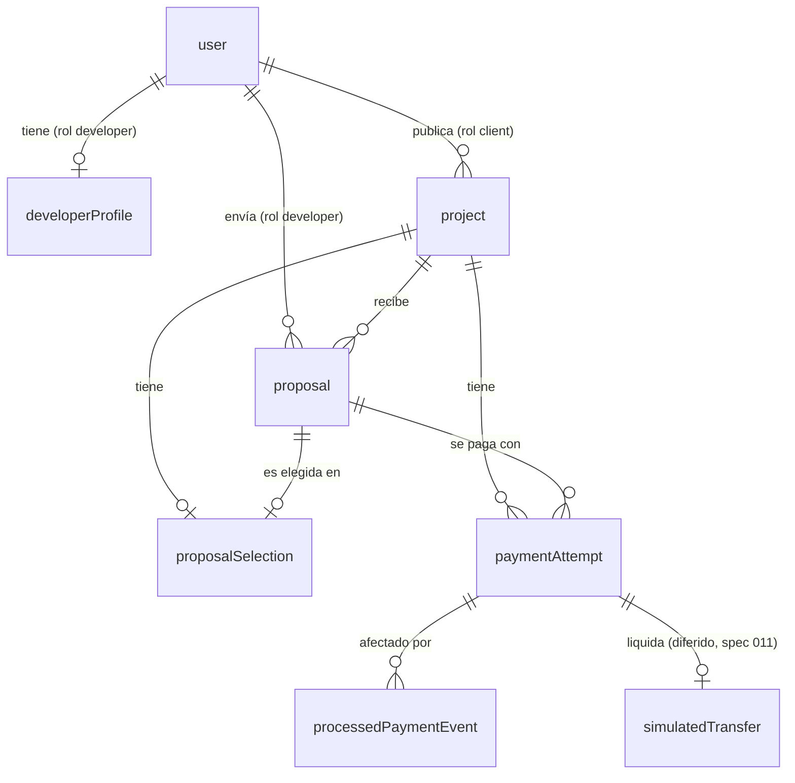

# Diseño del sistema de Nexora

Origen normativo: `docs/specs/002-product-domain-and-architecture.md` (aprobada). Los nombres de tablas y columnas finales los fija la spec 003. Cita las secciones como `system-design.md §N`. Cada sección es autocontenida: lee solo la que necesites.

---

## 1. Visión y principios

Nexora es un marketplace donde un cliente publica un proyecto, los desarrolladores envían propuestas, el cliente selecciona una y realiza un pago de prueba (Stripe Test Mode). Requisitos completos en `docs/BRIEF.md`; las reglas de negocio están en `BRIEF §7` (se enlazan, no se copian aquí).

Principios (resumen de `BRIEF §12`):

- Claridad en los estados y responsabilidades.
- Seguridad desde el diseño.
- Una sola propuesta ganadora por proyecto.
- Separación entre aceptación, pago confirmado y transferencia al desarrollador.
- No presentar operaciones de prueba como transacciones reales.
- MVP enfocado en el marketplace principal (YAGNI).

Traducción de las reglas de `BRIEF §7` a dominio:

| Regla BRIEF §7 | Traducción de dominio |
|---|---|
| 1, 3, 6 | `project.status = published` es la única condición que admite propuestas |
| 4, 5, 7 | `proposalSelection` 1:1 con proyecto; selección transaccional; solo el cliente propietario |
| 8 | Acceso a proyecto/propuesta/pago privados solo por propietario, autor o administrador (matriz en §6) |
| 9, 10, 11, 12 | El estado de pago solo cambia por webhook verificado; idempotencia vía `processedPaymentEvent`; `failed`/`canceled` nunca pasan a `completed_test` |
| 13, 14, 15 | `livemode=false` siempre; transferencia independiente del pago; sin comisiones |

---

## 2. Entidades y relaciones

Todas viven en Neon salvo indicación. Los nombres son conceptuales.

| Entidad | Propósito | Campos de negocio | Relaciones |
|---|---|---|---|
| Usuario (`user`) | Identidad interna vinculada a Clerk | `clerkUserId` (único), rol, nombre visible, email, fechas | 1 usuario : N proyectos (si cliente); 1 : N propuestas (si desarrollador); 1 : 0..1 perfil de desarrollador |
| Rol | Atributo del usuario, no entidad aparte | `client` \| `developer` \| `admin` | Un solo rol por usuario (D1) |
| Perfil del desarrollador (`developerProfile`) | Información pública/básica del desarrollador | titular, bio, tecnologías, enlace externo opcional | 1:1 con usuario (rol `developer`) |
| Proyecto (`project`) | Necesidad publicada por un cliente | título, categoría, descripción, presupuesto mín/máx USD, plazo en semanas, tecnologías (tags del catálogo), estado | N:1 cliente (usuario); 1:N propuestas; 0..1 selección; 0..N intentos de pago; N:M tecnologías |
| Tecnología (`technology`) | Tag del catálogo cerrado y compartido (lenguajes, frameworks, bases de datos, etc., más «Otros») | `slug` (único), nombre (único sin distinguir mayúsculas), orden | N:M con proyecto (tabla puente `project_technologies`) |
| Propuesta (`proposal`) | Oferta de un desarrollador a un proyecto | precio USD, plazo en semanas, descripción de la solución, estado | N:1 proyecto; N:1 desarrollador (usuario); como máximo una propuesta por desarrollador y proyecto (D5) |
| Selección de propuesta (`proposalSelection`) | Hecho inmutable "este proyecto eligió esta propuesta" | proyecto, propuesta, cliente que seleccionó, fecha | 1:1 con proyecto y 1:1 con propuesta; como máximo un ganador por proyecto |
| Intento de pago (`paymentAttempt`) | Un intento de pago en Stripe Checkout (test) | proyecto, propuesta ganadora, cliente, importe USD y moneda copiados de la propuesta en el servidor, id de Checkout Session, id de PaymentIntent (cuando exista), estado, `livemode=false` | N:1 proyecto; N:1 propuesta; como máximo un intento `pending` o `completed_test` por proyecto |
| Evento de pago procesado (`processedPaymentEvent`) | Registro para idempotencia de webhooks | `stripeEventId` (único), tipo, fecha de recepción, resultado del procesamiento | referencia opcional al intento de pago afectado |
| Registro de transferencia simulada (`simulatedTransfer`) | Liquidación al desarrollador, distinta del pago | intento de pago, desarrollador destino, estado | 1:1 con intento de pago `completed_test`. **Diferido** hasta la spec 011 (D6): antes, `transferStatus` se deriva del pago |

### Diagrama



### Invariantes de dominio

- I1. Máximo una selección por proyecto y una propuesta seleccionada por proyecto.
- I2. Importe y moneda de un intento de pago salen siempre de la propuesta ganadora guardada en servidor, nunca del cliente.
- I3. El pago (`paymentAttempt`) y la transferencia son entidades y estados independientes.
- I4. Ningún estado de pago `completed_test` se alcanza sin un evento de Stripe verificado en servidor.
- I5. Todo dato de pago en este alcance es de Test Mode y nunca se presenta como dinero real.

---

## 3. Propiedad de datos: Neon / Clerk / Stripe / Supabase Storage

Nexora no almacena credenciales, contraseñas ni datos de tarjeta. Cada categoría de dato tiene una única fuente de verdad.

| Dato | Fuente de verdad | Notas |
|---|---|---|
| Credenciales, contraseña, sesión, verificación de email, proveedores OAuth | Clerk | Nexora nunca los almacena |
| Identificador de identidad (`clerkUserId`) | Clerk | Copia en Neon como clave de vinculación única |
| Email y nombre visible | Clerk | Copia en Neon para listados y relaciones; la spec 004 define la sincronización; mínima exposición de datos personales |
| Rol de negocio | Neon (`user.role`) | Fuente de verdad de autorización. Puede reflejarse en metadata de Clerk solo como caché (D1) |
| Perfil del desarrollador, proyectos, propuestas, selecciones | Neon | Datos de dominio |
| Intentos de pago: estado, importe, relaciones con proyecto/propuesta | Neon | El estado local solo cambia por webhook verificado |
| Checkout Session, PaymentIntent, Event, instrumentos de pago, datos de tarjeta | Stripe | Neon guarda solo identificadores externos (únicos) y estado derivado. Nunca datos de tarjeta |
| Eventos de webhook procesados | Neon (`processedPaymentEvent`) | Copia del `event.id` para idempotencia |
| Archivos privados | Supabase Storage | MVP sin archivos; reservado. Acceso solo por URLs firmadas desde servidor (spec 015); Neon guardaría solo la ruta del objeto |
| Cuenta conectada del desarrollador (Stripe Connect) | Stripe | Id en Neon; fuera de alcance hasta la spec 011 |

---

## 4. Estructura de módulos y dependencias permitidas

Solo se crean las subcarpetas que cada spec de implementación necesite (YAGNI, `SETUP.md §1.5`).

```
src/
  modules/
    auth/        -> integración Clerk: resolver usuario actual y rol, guards de servidor (spec 004)
    users/       -> usuario interno + perfil del desarrollador (servicios, schemas, tipos)
    projects/    -> proyectos y su ciclo de vida (specs 005-006)
    proposals/   -> propuestas y selección de propuesta (specs 007-008)
    payments/    -> intentos de pago, eventos procesados, transferencia (specs 009-011)
  lib/
    db/          -> cliente Drizzle y schema (ubicación final: spec 003, D7)
  app/
    api/webhooks/stripe/route.ts   -> solo routing; delega a modules/payments (spec 010)
```

Dependencias permitidas (sin ciclos):

| Módulo | Puede depender de |
|---|---|
| `auth` | `users` (resuelve el usuario interno; spec 004, D-A) |
| `users` | (sin dependencias de otros módulos; nunca importa `auth`) |
| `projects` | `users`, `auth` |
| `proposals` | `projects`, `users`, `auth` |
| `payments` | `projects`, `proposals`, `users`, `auth` |

Reglas:

- Excepción acotada `projects` <-> `proposals` (spec 005 D-B, reescrita por spec 007 D-E/D-H):
  - Escritura: `projects` solo puede invocar funciones hoja de `proposals/services/proposal-transitions.ts` (p. ej. `rejectPendingProposals`, que `closeProject` llama dentro de su transacción al cerrar desde `published`). Ya no hace SQL de escritura sobre `proposals`. Esa función recibe el `tx`, no importa `db` ni `projects`.
  - Lectura: `projects` conserva la lectura de las tablas Drizzle `proposals` y `payments` (no sus servicios) para contar propuestas (D3) y comprobar intentos de pago (D2).
  - UI (spec 007 D-H): `projects/components/proposal-cta.tsx` importa `DeveloperProposalSection` de `proposals/components` (punto de extensión reservado por la spec 006). Es un import de UI `projects` -> `proposals`.
  - `proposals` nunca importa `project.service`; solo las tablas de `projects`.
  - Pagos (spec 009): `payments` escribe únicamente en `payment_attempts` (y en 010 en `processed_payment_events`) y solo lee las tablas Drizzle de `projects`, `proposals` y `users`; no importa sus servicios. El cliente de Stripe es el singleton `src/lib/stripe.ts` (solo servidor, rechaza claves live) y la lógica de negocio solo lo importa desde `@/lib/stripe`.
- Selección (spec 008): `proposals/services/proposal-selection.service.ts` escribe en `projects` solo mediante `projects/services/project-transitions.ts` (hoja que recibe el `tx`, no importa `db`, `project.service` ni nada de `proposals`); `projects` sigue sin importar servicios de `proposals`.
- La selección de propuesta es una operación transaccional que escribe en `proposals` y `projects`. Vive en `proposals` (servicio de selección) y usa una función de transición expuesta por `projects` (detalle en spec 008).
- La transición `proposal_selected -> contracted` la ejecuta el servicio de `payments` llamando a la función de transición de `projects`, nunca por SQL directo desde otro módulo.
- `src/app` es solo routing. Los clientes de Clerk, Stripe y Supabase son singletons mínimos en `src/lib`; la lógica de negocio vive en los módulos.
- El módulo se llama `users` (no `profile`/`accounts`) para agrupar usuario y perfil de desarrollador (D4).

---

## 5. Estados y transiciones

Resumen. El detalle (transiciones, disparadores, condiciones, diagramas y casos límite) vive en [`state-machines.md`](./state-machines.md). Los identificadores son canónicos (snake_case, inglés) y no admiten sinónimos.

### 5.1 Proyecto (`project.status`)

`draft`, `published`, `proposal_selected`, `contracted`, `closed` (terminal). Solo `published` admite propuestas. `contracted` solo se alcanza tras un webhook verificado que deja el pago en `completed_test`.

### 5.2 Propuesta (`proposal.status`)

`pending`, `accepted`, `rejected`, `withdrawn`. Los tres últimos son terminales. Exactamente una propuesta `accepted` por proyecto, vía la transacción de selección.

### 5.3 Intento de pago (`paymentAttempt.status`)

`pending`, `completed_test`, `failed`, `canceled`. Los tres últimos son terminales; un reintento crea un intento nuevo. La ausencia de intento equivale a "No iniciado" (no se almacena). Solo un webhook verificado cambia el estado.

### 5.4 Transferencia (`transferStatus`)

`not_applicable`, `pending_implementation`, `simulated`. Independiente del pago (I3); hasta la spec 011 se deriva del pago y no se almacena. Nunca se muestra como dinero recibido.

---

## 6. Roles y permisos

Matriz de alto nivel derivada de `BRIEF §4`. El enforcement (guards, middleware, sincronización) es la spec 004.

| Acción | Visitante | Cliente | Desarrollador | Administrador |
|---|---|---|---|---|
| Ver catálogo y detalle de proyectos `published` | sí | sí | sí | sí |
| Crear/editar/publicar/cerrar proyecto propio | no | sí | no | cierre/soporte |
| Ver propuestas de un proyecto | no | solo de proyectos propios | solo las propias | sí (lectura) |
| Enviar/retirar propuesta | no | no | sí (proyecto `published`) | no |
| Seleccionar propuesta | no | solo en proyecto propio | no | no |
| Iniciar pago de prueba | no | solo en proyecto propio con propuesta seleccionada | no | no |
| Ver estado de pago | no | proyectos propios | su propuesta ganadora | sí (lectura) |

Notas:

- Un solo rol por usuario (`client` | `developer` | `admin`), fijado al registrarse (D1). Un cliente no puede enviar propuestas a su propio proyecto.
- El rol de administrador se asigna fuera de la app (manualmente). D8 confirmada en la spec 004: el administrador lee proyectos, propuestas y pagos y puede cerrar proyectos; no modera, no edita contenido ajeno, no inicia pagos, no selecciona propuestas y no cambia roles desde la app (ver `docs/specs/004-authentication-and-authorization.md`, RF7 y R3).
- La información de contacto privada solo es visible según permisos (`BRIEF §6.6`); la spec 013 define qué datos ve el desarrollador ganador.

---

## 7. Pagos y webhooks: principios

- **Test Mode siempre.** Todo pago es de prueba (`livemode=false`) y nunca se presenta como dinero real (I5).
- **Importe desde el servidor.** Importe y moneda se toman de la propuesta ganadora guardada en servidor, nunca del navegador (I2).
- **Verificación de firma.** Todo evento de Stripe se acepta solo con firma válida verificada en servidor.
- **El navegador no es fuente de verdad.** Las páginas de retorno (éxito o cancelación) solo informan; nunca cambian el estado del pago ni del proyecto. Si el navegador vuelve antes del webhook, la UI muestra "verificando" y no afirma pago completado.
- **Solo el webhook transiciona.** `pending -> completed_test|failed|canceled` y `proposal_selected -> contracted` dependen de un webhook verificado (I4).
- **Idempotencia.** Cada `event.id` se registra en `processedPaymentEvent` (único); un evento repetido no cambia estado.
- **Sin regresiones.** Un evento tardío o fuera de orden nunca revierte `completed_test` ni reabre un estado terminal.
- **Pago y transferencia separados** (I3). Sin comisiones.
- **Sin datos sensibles.** Nunca se guardan datos de tarjeta; solo identificadores externos únicos y estado derivado.
- La ruta de webhook (`src/app/api/webhooks/stripe/route.ts`) solo hace routing y delega a `modules/payments`. Contratos detallados en las specs 009-010; Stripe Connect en la 011.

---

## 8. Decisiones registradas

### Confirmadas

- Stack de `BRIEF §9`: Clerk, Drizzle ORM + Neon Postgres, Supabase Storage, Stripe, Zod.
- Stripe Connect en test mode como último paso (spec 011); mientras tanto la transferencia es "pendiente de implementación".
- Prefijo `NNN-slug.md` para specs en `docs/specs/`.
- Esta arquitectura se documenta en `docs/architecture/` y se referencia desde `SETUP.md §4`.

### D1-D11 (aprobadas con la propuesta por defecto)

| Id | Decisión | Spec destino |
|---|---|---|
| D1 | Un solo rol por usuario (`client` \| `developer` \| `admin`), elegido al registrarse y no modificable en el MVP; fuente de verdad `user.role` en Neon, con caché opcional en metadata de Clerk | 003, 004 |
| D2 | `proposal_selected -> closed` permitido mientras no exista pago `completed_test`; con intento `pending` hay que cancelarlo o esperar su resolución. No se reabre la selección en el MVP | 010, 012 |
| D3 | `published -> draft` solo si el proyecto no tiene propuestas | 005 |
| D4 | Perfil del desarrollador dentro del módulo `users` (sin módulo `profile`) | 003 |
| D5 | Una propuesta por desarrollador por proyecto (unicidad); editable mientras `pending`; no se permite reenviar tras retirar | 003, 007 |
| D6 | No se crea `simulatedTransfer` hasta la spec 011; antes `transferStatus` se deriva del pago | 011 |
| D7 | Ubicación del cliente Drizzle y schema: se reserva `src/lib/db`; decisión final en la spec 003 | 003 |
| D8 | Admin: lectura de proyectos/propuestas/pagos y cierre de proyectos; sin moderación | 004 |
| D9 | Solo USD en el MVP, moneda almacenada con el importe; decimales/centavos se deciden en la spec 003 | 003 |
| D10 | Convención de variables de entorno y `.env.example`: **resuelta para las variables de Stripe en la spec 009** (nombres `UPPER_SNAKE`, secretos nunca con `NEXT_PUBLIC_`, `.env.example` solo con nombres agrupados por proveedor, `.env.local` nunca se commitea). `STRIPE_SECRET_KEY` y `APP_URL` son solo de servidor; `STRIPE_WEBHOOK_SECRET` llega con la spec 010. El valor por entorno queda para la 017 | 009, 017 |
| D11 | Tecnologías de un proyecto como **catálogo cerrado** en BD (`technologies`) con relación N:M (`project_technologies`), en lugar de texto libre; se identifican por `slug` en formularios y URL, mínimo 1 y máximo 10 por proyecto. «Otros» es solo una etiqueta (sin texto asociado). El alta de tags se hace por migración. `developer_profiles.technologies` queda fuera de alcance (texto libre) | 009c |

Cualquier cambio de arquitectura requiere una spec aprobada.
